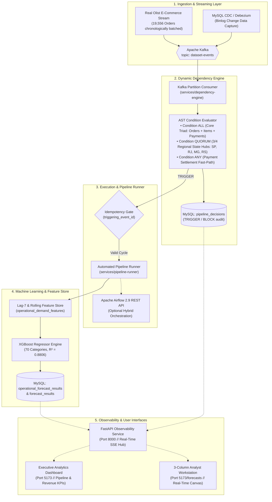

# SupplySense AI

[](https://www.python.org/)
[](https://fastapi.tiangolo.com)
[](https://kafka.apache.org/)
[](https://xgboost.ai/)
[](https://www.mysql.com/)
[](https://react.dev/)
[](https://www.docker.com/)

**SupplySense AI** is an enterprise-grade, event-conditioned data pipeline orchestrator and predictive demand forecasting platform. It eliminates rigid time-based cron schedules by dynamically evaluating dataset readiness conditions across distributed Kafka event streams before triggering downstream ML inference and ETL workloads.

> **Core Philosophy:** *Execute downstream computational workloads only when upstream data dependencies are synchronized, validated, and ready — never simply because a clock elapsed.*

---

## Architecture Overview



---

## Key System Capabilities

### 1. Multi-Condition Dependency Engine
- **`Condition ALL` (Core Triad):** Requires concurrent synchronization of orders, order items, and payment datasets before triggering forward demand forecasting.
- **`Condition QUORUM` (3 of 4 State Hubs):** Tolerates regional logistics delays by executing regional dispatch when at least 3 out of 4 critical federal states (SP, RJ, MG, RS) have reported sync events.
- **`Condition ANY` (Payment Rails Fast-Path):** Dispatches immediate settlement jobs upon arrival of Boleto, Credit Card, or Voucher transactions.

### 2. High-Precision Machine Learning Forecasting
- **Algorithm:** XGBoost Regressor (`xgboost-v1`, tree depth 6, learning rate 0.05, objective `reg:squarederror`).
- **Data Provenance:** Strict chronological split on real Brazilian E-Commerce data (99,441 transactions):
  - **Part 1 (Historical Training):** 79,885 orders (2016-09 through 2018-05-28).
  - **Part 2 (Streaming Simulation):** 19,556 orders streamed in chronological batches to Kafka.
  - **Holdout Test Set:** 14 calendar weeks (770 evaluation records across 70 product categories).
- **Benchmarked Accuracy:**
  - **$R^2 = 0.8806$** (variance explained)
  - **$\text{MAPE} = 14.8\%$**
  - **$\text{RMSE} = 3.42$** | **$\text{MAE} = 2.18$**

### 3. Dual-Interface Web Observability
- **Executive Operations Dashboard (`/`):**
  - Top-level 4-step orchestration flow banner for external stakeholders.
  - Category-level GMV & physical sales volume charts across Brazil's top 10 retail sectors.
  - Top 10 bestselling individual products (SKUs) and catalog price-tier distributions.
  - Zero-blocking UI architecture with sub-millisecond initial paint.
- **Advanced 3-Column Analyst Workstation (`/forecasts`):**
  - **Left Panel (Controls):** JSON/CSV raw data importer, temporal aggregation toggles (Hourly, Daily, Weekly), confidence interval & moving average sliders, and one-click report export.
  - **Center Panel (Interactive Canvas):** Switchable between Multi-Series Line Chart (with actual overlay and CI bounds), Area Accumulation Chart, and a Prediction Variance Heatmap Matrix.
  - **Right Panel (Operations Grid):** Raw data grid with cell-level inline editing, multi-column sorting, regex search, and an interactive execution log terminal.

### 4. Enterprise Resilience & Idempotency
- **Strict Idempotency:** Guarded by `UNIQUE KEY (pipeline_name, triggering_event_id)` preventing duplicate executions on replayed Kafka events.
- **Stale Execution Reaper:** Automatically recovers orphaned or stalled jobs using configurable timeouts and exponential backoff.
- **Clean Shutdown Protocol:** Gracefully terminates async background workers and event loop listeners on `SIGINT` / `SIGTERM`.

---

## Technology Stack

| Component | Technology | Version | Purpose |
|---|---|---|---|
| **Language Runtime** | Python | 3.11 / 3.13 | Primary application runtime |
| **API Framework** | FastAPI + Uvicorn | 0.115+ | Observability REST & Server-Sent Events (SSE) |
| **Event Streaming** | Apache Kafka | 4.3 (KRaft) | High-throughput distributed event messaging |
| **Database** | MySQL Server | 8.0 | Operational feature store & relational metadata |
| **ML Engine** | XGBoost + scikit-learn | 2.1+ | Gradient boosted tree forecasting models |
| **Frontend Framework** | React + Vite | 18.3 / 5.4 | High-density real-time analyst interfaces |
| **Styling & Charts** | Tailwind CSS + Recharts | 3.4 / 2.12 | Technical dark UI & data visualizations |
| **Containerization** | Docker Compose | 3.8 | Multi-service local environment orchestration |

---

## Repository Structure

```
SupplySense-AI/
├── config/                 # Centralized environment & service settings
├── database/
│   ├── migrations/         # SQL migrations 001–020 (Applied sequentially)
│   └── seeds/              # Seed scripts for operational inventory
├── docs/                   # Architectural blueprints & demo runbooks
├── frontend/               # React 18 + Vite frontend workspace
│   └── src/
│       ├── api/            # Centralized API client & HTTP interceptors
│       ├── components/     # Reusable UI cards, tables, and modals
│       └── pages/          # Dashboard, Forecasts, Datasets, Dependencies, Executions
├── ml/
│   ├── features/           # Lag-7 feature engineering & category encodings
│   ├── models/             # Trained XGBoost serialized model binaries
│   └── results/            # Model performance benchmarks & holdout evaluations
├── scripts/                # Operational CLI scripts & verification runners
├── services/
│   ├── dependency-engine/  # Kafka consumer & AST condition evaluation engine
│   ├── feature_pipeline/   # Rolling window feature matrix builder
│   ├── forecasting/        # Forward inference execution service
│   ├── observability/      # FastAPI telemetry server & SSE event hub
│   ├── pipeline-runner/    # Idempotent pipeline dispatcher & handlers
│   └── simulator/          # Kafka real-time Olist chronological stream replay
└── tests/
    ├── integration/        # Database and pipeline integration test suites
    └── unit/               # Mocked unit tests for evaluator, APIs, and rules
```

---

## Quickstart Guide

### 1. Prerequisites
- **Python 3.11+** installed with virtual environment support.
- **Node.js 18+** & **npm** for the frontend application.
- **Docker Desktop** (with Compose v2) for Kafka and MySQL.

### 2. Environment Setup
Clone the repository and initialize the Python virtual environment:
```powershell
git clone git@github-old:Varun-sai018/SupplySense-AI.git
cd SupplySense-AI

python -m venv .venv
.\.venv\Scripts\Activate.ps1
pip install -r requirements.txt
```

Copy the environment template:
```powershell
Copy-Item .env.example .env
```

### 3. Launch Docker Infrastructure
Start the Kafka broker and MySQL database container:
```powershell
docker compose up -d
```
*Database migrations (`001` through `020`) apply automatically on initial MySQL boot.*

### 4. Start the Observability Backend
In your primary terminal, launch the FastAPI server:
```powershell
.\.venv\Scripts\python.exe -m uvicorn services.observability.main:app --host 127.0.0.1 --port 8000 --reload
```
- API Health Check: [http://127.0.0.1:8000/health](http://127.0.0.1:8000/health)
- Swagger OpenAPI Docs: [http://127.0.0.1:8000/docs](http://127.0.0.1:8000/docs)

### 5. Start the React Frontend
In a secondary terminal, start the Vite development server:
```powershell
cd frontend
npm install
npm run dev
```
- Executive Dashboard: [http://127.0.0.1:5173](http://127.0.0.1:5173)
- Real-Time Forecast Workstation: [http://127.0.0.1:5173/forecasts](http://127.0.0.1:5173/forecasts)

### 6. Run the Dependency Engine (Optional for Live Kafka Streaming)
In a third terminal, start the Kafka stream listener:
```powershell
.\.venv\Scripts\python.exe -m services.dependency-engine.main
```

---

## Service Endpoints & Port Map

| Component | URL / Address | Credentials / Notes |
|---|---|---|
| **Executive Dashboard** | `http://127.0.0.1:5173` | React 18 + Tailwind |
| **Analyst Workstation** | `http://127.0.0.1:5173/forecasts` | 3-Column Real-Time Workstation |
| **Observability API** | `http://127.0.0.1:8000` | FastAPI ASGI Server |
| **API Documentation** | `http://127.0.0.1:8000/docs` | Interactive Swagger UI |
| **Apache Kafka Broker** | `localhost:9092` | KRaft Mode (No Zookeeper) |
| **MySQL Database** | `localhost:3306` | User: `root` / Pass: `root` / DB: `supplysense` |

---

## Core API Reference

All observability endpoints are non-blocking and optimized for real-time dashboards:

| Method | Endpoint | Description |
|---|---|---|
| `GET` | `/health` | Liveness check and MySQL database connectivity |
| `GET` | `/api/observability/summary` | Global pipeline execution counts, success rates, and active dataset sync status |
| `GET` | `/api/observability/executions` | Paginated pipeline executions list with duration, status, and artifact locations |
| `GET` | `/api/observability/datasets` | Real-time status for all 13 registered datasets |
| `GET` | `/api/observability/dependencies` | Configured dependency conditions (`ALL`, `QUORUM`, `ANY`) and evaluated readiness states |
| `GET` | `/api/observability/dependencies/events` | Stream of live Kafka dataset update events with payload metadata |
| `GET` | `/api/observability/forecasts` | Aggregated demand forecast model execution runs |
| `GET` | `/api/observability/forecasts/{id}/category-trends` | 14-week predicted category trends formatted for charting engines |
| `GET` | `/api/observability/forecasts/{id}/products` | Product-level (SKU) demand estimates, prices, and stockout risk |
| `GET` | `/api/observability/events/stream` | Server-Sent Events (SSE) real-time feed for instantaneous client sync |

---

## Testing & Quality Assurance

The platform includes a comprehensive test suite of **over 220 automated unit and integration tests** validating data idempotency, condition evaluation, AST rules, and API endpoints:

```powershell
# Run the entire test suite
.\.venv\Scripts\python.exe -m unittest discover -s tests -p "test_*.py"
```

To run targeted test modules:
```powershell
# Unit tests (Mocked, no external dependencies required)
.\.venv\Scripts\python.exe -m unittest tests/unit/test_hybrid_dependency_engine.py

# Integration tests (Requires running MySQL instance)
.\.venv\Scripts\python.exe -m unittest tests/integration/test_phase5_realtime_pipeline_e2e.py
```

---

## License

This project is released under the **MIT License**.
Distributed for enterprise research and advanced agentic data pipeline engineering.
