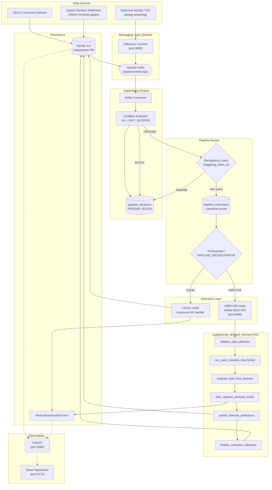

# SupplySense AI

**SupplySense AI** is an event-conditioned data pipeline orchestration platform for supply-chain demand forecasting. Data events arrive from multiple sources, dependency conditions are evaluated against dataset readiness, and eligible pipelines are triggered automatically — without relying on fixed cron schedules.

> **Core philosophy:** *Run downstream data pipelines when all required data dependencies are actually synchronized, validated, and ready — not simply because a schedule elapsed.*

---

## Table of Contents

1. [Project Overview](#1-project-overview)
2. [Key Features](#2-key-features)
3. [Architecture](#3-architecture)
4. [Technology Stack](#4-technology-stack)
5. [Repository Structure](#5-repository-structure)
6. [Prerequisites](#6-prerequisites)
7. [Environment Configuration](#7-environment-configuration)
8. [Installation and Startup](#8-installation-and-startup)
9. [Airflow Forecasting Workflow](#9-airflow-forecasting-workflow)
10. [API and Dashboard](#10-api-and-dashboard)
11. [Database and Migrations](#11-database-and-migrations)
12. [Machine Learning Methodology](#12-machine-learning-methodology)
13. [Testing](#13-testing)
14. [Project Status and Roadmap](#14-project-status-and-roadmap)
15. [Limitations and Security](#15-limitations-and-security)
16. [Contribution and Git Workflow](#16-contribution-and-git-workflow)

---

## 1. Project Overview

SupplySense AI coordinates downstream demand forecasting pipelines based on upstream dataset availability across supply-chain networks. The system separates concerns across five layers:

| Layer | Responsibility |
|---|---|
| **Dependency Engine** | Evaluates dataset readiness conditions and decides **when** a pipeline is eligible to run (TRIGGER or BLOCK). |
| **Pipeline Runner** | Receives TRIGGER decisions and dispatches execution to the configured orchestrator. |
| **Apache Airflow** | Manages **how** the demand forecasting workflow executes, including task sequencing, retry, and observability. |
| **ML Pipeline** | Generates demand forecasts using a naive baseline benchmark and an XGBoost regressor; persists results. |
| **Observability API + React Dashboard** | Exposes read-only execution telemetry, dataset status, dependency decisions, and forecast summaries. |

---

## 2. Key Features

- **Event-driven dependency evaluation** — Kafka events trigger dependency evaluation rather than scheduled polling.
- **ALL / ANY / QUORUM conditions** — Three dependency condition types control when a pipeline is eligible to run.
- **TRIGGER / BLOCK decisions** — Each event evaluation produces an audited decision record in `pipeline_decisions`.
- **Idempotent execution creation** — A `UNIQUE KEY (pipeline_name, triggering_event_id)` prevents duplicate execution records for the same event.
- **Square sandbox webhook ingestion** — HMAC-SHA256 signed webhooks from the Square sandbox are received and normalized.
- **Debezium / Kafka CDC integration** — MySQL binlog change events stream via Debezium Connect into the `dataset-events` Kafka topic.
- **CDC deduplication and micro-batching** — `source_change_id` deduplication and configurable micro-batch consolidation.
- **LOCAL and AIRFLOW orchestration modes** — `PIPELINE_ORCHESTRATOR` selects between in-process execution and Apache Airflow REST API dispatch.
- **Deterministic Airflow run IDs** — Run IDs are computed as `supplysense_exec_{execution_id}_attempt_{retry_count}` before the HTTP trigger call, enabling idempotent retries.
- **Exponential backoff retry policy** — Transient failures are classified and retried with configurable bounded backoff.
- **Stale-execution reaper with Airflow reconciliation** — The reaper queries Airflow for the recorded run state before marking any AIRFLOW-orchestrated execution FAILED.
- **Execution-scoped artifact isolation** — Each execution writes artifacts to `ml/results/executions/<execution_id>/`.
- **FastAPI observability endpoints** — Read-only REST API for executions, datasets, dependencies, and forecasts.
- **React observability dashboard** — Five-page dashboard polling the observability API every five seconds.

> **Note:** Features involving Square webhooks, Debezium CDC, and live Airflow runs require valid local configuration and running external services. Unit tests use mocks and do not verify live external integrations.

---

## 3. Architecture



> Dashed lines indicate read-only queries. Components inside the Docker Compose stack (Kafka, Debezium, MySQL, Airflow) require `docker compose up` to be running. MySQL runs in Docker; Python services run on the Windows host.

---

## 4. Technology Stack

| Technology | Version | Role |
|---|---|---|
| **Python** | 3.11 / 3.13 | Core application runtime |
| **FastAPI** | latest | Observability REST API |
| **Uvicorn** | latest | ASGI server for FastAPI |
| **PyMySQL** | latest | MySQL database driver |
| **XGBoost** | latest | Demand forecasting model |
| **scikit-learn** | latest | Data preprocessing utilities |
| **pandas** | latest | Dataset manipulation |
| **kafka-python** | latest | Kafka producer and consumer |
| **requests / httpx** | latest | Airflow REST API client; async HTTP |
| **python-dotenv** | latest | Environment variable loading |
| **Apache Airflow** | 2.9.3-python3.11 | DAG orchestration (Docker) |
| **MySQL** | 8.0 | Primary relational store (Docker) |
| **Apache Kafka** | 4.3.1 | Event streaming (Docker, KRaft mode) |
| **Debezium Connect** | 2.7.3.Final | MySQL CDC connector (Docker) |
| **PostgreSQL** | 15-alpine | Airflow metadata database (Docker) |
| **React** | 18.3.1 | Observability dashboard |
| **Vite** | 5.4.8 | React build and dev server |
| **Tailwind CSS** | 3.4.13 | Dashboard styling |
| **Recharts** | 2.12.7 | Dashboard charts |
| **react-router-dom** | 6.26.2 | Dashboard client-side routing |
| **Docker Compose** | 3.8 | Infrastructure orchestration |

> Exact Python package versions are unpinned in [`requirements.txt`](requirements.txt). Pin versions for reproducible production deployments.

---

## 5. Repository Structure

```
capstone/
├── common/                         # Shared database connection helper
├── config/
│   └── settings.py                 # All environment variable bindings
├── dags/
│   └── supplysense_demand_forecast.py  # Airflow demand forecasting DAG
├── data/
│   ├── processed/                  # Prepared train/validation/test CSVs
│   └── scripts/                    # Olist dataset upload helper
├── database/
│   └── migrations/                 # SQL migrations 001–012 (applied in order)
├── docs/                           # Per-phase documentation and runbooks
├── frontend/                       # React + Vite observability dashboard
│   └── src/
│       └── pages/                  # Dashboard, Executions, Datasets,
│                                   # Dependencies, Forecasts pages
├── ml/
│   ├── baseline/                   # Naive baseline benchmark
│   ├── data/                       # Dataset preparation and splitting
│   ├── features/                   # Feature engineering
│   ├── models/                     # XGBoost training and evaluation
│   └── results/                    # Shared metrics + per-execution artifacts
├── scripts/                        # Operational CLI scripts
│   ├── reap_stale_executions.py    # Stale execution reaper CLI
│   ├── process_pipeline_retries.py # Retry service CLI
│   └── demo_e2e_capstone.py        # End-to-end demonstration script
├── services/
│   ├── cdc-adapter/                # Debezium CDC adapter and batcher
│   ├── dependency-engine/          # Kafka consumer + dependency evaluator
│   ├── event-generator/            # Synthetic dataset event generator
│   ├── kafka-producer/             # Manual Kafka event producer
│   ├── observability/              # FastAPI observability service
│   ├── pipeline-runner/            # Pipeline Runner, Airflow client, reaper, retry
│   └── realtime-api/               # Square webhook receiver
├── tests/
│   ├── integration/                # Integration tests (require MySQL)
│   └── unit/                       # Unit tests (mocked dependencies)
├── .env.example                    # Environment variable template
├── docker-compose.yml              # Full infrastructure stack
└── requirements.txt                # Python dependencies
```

---

## 6. Prerequisites

### Required for all workflows

| Requirement | Notes |
|---|---|
| **Python 3.11+** | 3.13 also supported |
| **pip** | Included with Python |
| **Git** | For cloning and version control |

### Required for event-driven pipeline execution

| Requirement | Notes |
|---|---|
| **Docker Desktop** | Runs MySQL, Kafka, Debezium, and Airflow containers |
| **Docker Compose v2** | Bundled with Docker Desktop |

### Required for the React dashboard

| Requirement | Notes |
|---|---|
| **Node.js 18+** | Check with `node --version` |
| **npm** | Bundled with Node.js |

### Optional external integrations

| Requirement | Notes |
|---|---|
| **Square sandbox account** | Required only for Square webhook ingestion |
| **Olist raw CSV files** | Required only to re-run the initial data preparation step |

---

## 7. Environment Configuration

Copy the template and fill in values for your environment:

```powershell
Copy-Item .env.example .env
```

The following variables are used by the application. All Airflow variables are **optional** and only needed when `PIPELINE_ORCHESTRATOR=AIRFLOW`.

### Core (required)

| Variable | Example | Description |
|---|---|---|
| `DB_HOST` | `localhost` | MySQL host. Use `localhost` when MySQL runs in Docker on Windows. |
| `DB_PORT` | `3306` | MySQL port. |
| `DB_USER` | `root` | MySQL username. |
| `DB_PASSWORD` | `root` | MySQL password. **Change for production.** |
| `DB_NAME` | `supplysense` | MySQL database name. |
| `KAFKA_BROKER` | `localhost:9092` | Kafka bootstrap server address. |
| `KAFKA_TOPIC_EVENTS` | `dataset-events` | Kafka topic for dataset events. |
| `KAFKA_CONSUMER_GROUP` | `dependency-engine` | Kafka consumer group ID. |
| `OLIST_DATA_DIR` | `./data/raw_csv` | Path to raw Olist CSV files. |

### Pipeline execution (optional, have defaults)

| Variable | Default | Description |
|---|---|---|
| `PIPELINE_EXECUTION_STALE_TIMEOUT_SECONDS` | `1800` | Seconds before a RUNNING execution is considered stale by the reaper. |
| `PIPELINE_MAX_RETRIES` | `3` | Maximum automated retry attempts per execution. |
| `PIPELINE_RETRY_BASE_DELAY_SECONDS` | `5` | Base delay for exponential backoff. |
| `PIPELINE_RETRY_MAX_DELAY_SECONDS` | `60` | Maximum retry delay ceiling. |

### Airflow orchestration (optional, have defaults)

| Variable | Default | Description |
|---|---|---|
| `PIPELINE_ORCHESTRATOR` | `LOCAL` | `LOCAL` = in-process ML handler. `AIRFLOW` = Airflow REST API dispatch. |
| `AIRFLOW_BASE_URL` | `http://localhost:8080` | Airflow webserver REST API base URL. Use `http://localhost:18080` if host port 8080 is remapped due to local collisions. |
| `AIRFLOW_API_USER` | `admin` | Airflow API username. **Development only — change for production.** |
| `AIRFLOW_API_PASSWORD` | `admin` | Airflow API password. **Development only — change for production.** |
| `AIRFLOW_DAG_ID` | `supplysense_demand_forecast` | Target DAG ID for REST API dispatch. |
| `AIRFLOW_REQUEST_TIMEOUT_SECONDS` | `10` | HTTP timeout for Airflow API calls. |

### Square (optional, only for webhook ingestion)

| Variable | Description |
|---|---|
| `SQUARE_ACCESS_TOKEN` | Square sandbox access token. |
| `SQUARE_LOCATION_ID` | Square sandbox location ID. |
| `SQUARE_WEBHOOK_SIGNATURE_KEY` | Square webhook signature verification key. |

> [!CAUTION]
> Never commit your `.env` file to version control. The `.gitignore` already excludes it. Development credentials (`root`/`root`, `admin`/`admin`) must not be used in any production or shared environment.

---

## 8. Installation and Startup

### Step 1 — Clone and create the virtual environment

```powershell
git clone git@github-old:Varun-sai018/SupplySense-AI.git
cd SupplySense-AI

python -m venv .venv
.\.venv\Scripts\Activate.ps1

pip install -r requirements.txt
```

### Step 2 — Configure environment

```powershell
Copy-Item .env.example .env
# Edit .env with your actual values
notepad .env
```

### Step 3 — Start Docker infrastructure

```powershell
docker compose up -d
```

This starts: MySQL 8.0, Kafka (KRaft), Debezium Connect, PostgreSQL (Airflow metadata), Airflow webserver, and Airflow scheduler.

Database migrations (`001`–`012`) are applied automatically on first MySQL container startup via the `docker-entrypoint-initdb.d` volume mount.

**Verify services are healthy:**

```powershell
docker compose ps
```

Wait until `supplysense-airflow-webserver` shows `healthy` (typically 60–90 seconds after `up`).

> [!NOTE]
> If host port 8080 is already occupied by a local Windows service (e.g. Java/Tomcat), update `docker-compose.yml` to map `18080:8080` for `supplysense-airflow-webserver` and set `AIRFLOW_BASE_URL=http://localhost:18080` in `.env`.

```powershell
# Confirm Airflow webserver is responsive (use port 18080 if remapped)
Invoke-WebRequest -Uri http://localhost:8080/health -UseBasicParsing | Select-Object -ExpandProperty Content
```

```powershell
# Confirm MySQL is accessible from the host
.\.venv\Scripts\python.exe -c "from common.database import get_connection; c = get_connection(); print('MySQL OK'); c.close()"
```

### Step 4 — Start the Observability API

```powershell
.\.venv\Scripts\python.exe -m uvicorn services.observability.main:app --host 127.0.0.1 --port 8000 --reload
```

Verify at: [http://127.0.0.1:8000/health](http://127.0.0.1:8000/health)
Interactive API docs: [http://127.0.0.1:8000/docs](http://127.0.0.1:8000/docs)

### Step 5 — Start the React dashboard

```powershell
cd frontend
npm install        # First time only
npm run dev
```

Dashboard: [http://127.0.0.1:5173](http://127.0.0.1:5173)

The Vite dev server proxies `/api` and `/health` to the Observability API on port 8000.

### Step 6 — Start the Dependency Engine (event-driven mode)

The Dependency Engine is a long-running Kafka consumer. Start it in a separate terminal with the virtual environment activated:

```powershell
.\.venv\Scripts\python.exe -m services.dependency-engine.main
```

Requires Kafka to be running and reachable at `KAFKA_BROKER`.

### Stopping services safely

```powershell
# Stop Docker services (preserves all data volumes)
docker compose down

# To also remove data volumes (destructive — removes all MySQL and Airflow data)
# docker compose down -v
```

> [!WARNING]
> `docker compose down -v` removes all persisted data including the MySQL `supplysense` database. Only run this if you intend to start from scratch.

### Service addresses

| Service | Address | Notes |
|---|---|---|
| Observability API | http://127.0.0.1:8000 | FastAPI, host process |
| API Docs (Swagger) | http://127.0.0.1:8000/docs | FastAPI auto-generated |
| React Dashboard | http://127.0.0.1:5173 | Vite dev server, host process |
| Airflow UI | http://localhost:8080 (or :18080) | Docker container, admin/admin |
| Kafka | localhost:9092 | Docker container |
| Debezium Connect | http://localhost:8083 | Docker container |
| MySQL | localhost:3306 | Docker container |

---

## 9. Airflow Forecasting Workflow

### DAG: `supplysense_demand_forecast`

The DAG is defined in [`dags/supplysense_demand_forecast.py`](dags/supplysense_demand_forecast.py). It is scheduled on-demand only (`schedule_interval=None`) and must be triggered with an explicit `execution_id` in `dag_run.conf`.

**Task sequence (linear):**

| # | Task ID | Description |
|---|---|---|
| 1 | `validate_input_datasets` | Verifies `train.csv`, `validation.csv`, `test.csv` exist. Validates that the provided `execution_id` exists in `pipeline_executions`. Updates execution status to `RUNNING`. Creates the scoped artifact directory. |
| 2 | `run_naive_baseline_benchmark` | Runs the 1-step naive rolling persistence baseline. Writes metrics to the scoped artifact directory. |
| 3 | `engineer_leak_free_features` | Builds the continuous-grid feature set with causal lag, rolling, and calendar features. Writes `forecasting_features.csv`. |
| 4 | `train_xgboost_demand_model` | Trains XGBoost regressor with validation-based early stopping. Writes model file and prediction CSVs to the scoped artifact directory. |
| 5 | `persist_forecast_predictions` | Persists test-split predictions to the `forecast_results` MySQL table (model version: `xgboost-v1`). |
| 6 | `finalize_execution_telemetry` | Verifies expected artifacts exist. Updates `pipeline_executions` status to `COMPLETED` using a strict `airflow_run_id` match. Logs execution summary. |

**Idempotency guarantees:**
- The DAG does **not** create a new canonical execution record. It requires an existing record in `pipeline_executions` created by the Dependency Engine.
- Each Airflow DAG run ID is deterministic: `supplysense_exec_{execution_id}_attempt_{retry_count}`.
- The `finalize_execution_telemetry` task only marks `COMPLETED` if the row's `airflow_run_id` matches the current run's ID, preventing late callbacks from a previous attempt from corrupting a newer retry.

**Triggering via the Airflow UI (manual):**

1. Open the [Airflow UI](http://localhost:8080) and log in with `admin` / `admin`.
2. Navigate to **DAGs → supplysense_demand_forecast**.
3. Click **Trigger DAG w/ config** and provide:

```json
{
  "execution_id": 1,
  "pipeline_name": "Demand Forecast Pipeline"
}
```

> [!IMPORTANT]
> `execution_id` must refer to an existing row in the `pipeline_executions` table. The DAG will fail validation if the record does not exist. Do not use a fabricated ID.

**Triggering via PIPELINE_ORCHESTRATOR=AIRFLOW:**

When `PIPELINE_ORCHESTRATOR=AIRFLOW` is set, the Pipeline Runner dispatches to the Airflow REST API automatically on each TRIGGER decision. The Dependency Engine then delegates lifecycle management to Airflow.

**Execution-scoped artifacts:**

Each DAG run writes output to `ml/results/executions/<execution_id>/`:

```
ml/results/executions/<execution_id>/
├── model_comparison.json
├── xgboost_metrics.json
├── baseline_metrics.json
├── baseline_metrics.csv
├── xgboost_demand_model.json
├── xgboost_validation_predictions.csv
├── xgboost_test_predictions.csv
├── baseline_validation_predictions.csv
└── baseline_test_predictions.csv
```

Shared (non-execution-scoped) results are in `ml/results/`.

---

## 10. API and Dashboard

### Observability REST API

Base URL: `http://127.0.0.1:8000`
Interactive docs: `http://127.0.0.1:8000/docs`

All endpoints are read-only (GET only).

| Endpoint | Description |
|---|---|
| `GET /health` | Service liveness and database connectivity check. |
| `GET /api/observability/summary` | High-level metrics: execution counts by status, success/failure rates, average duration, latest execution summary, dataset status counts, and latest forecast summary. |
| `GET /api/observability/executions` | Recent pipeline executions ordered newest first. Optional query params: `status` (RUNNING / COMPLETED / FAILED), `pipeline_name`, `limit` (1–100, default 20). Includes `orchestrator`, `airflow_dag_id`, `airflow_run_id`. |
| `GET /api/observability/executions/{execution_id}` | Detailed telemetry for a single execution: decision context, forecast summary, artifact verification, and Airflow metadata. |
| `GET /api/observability/datasets` | Synchronization and event tracking status for all registered datasets. |
| `GET /api/observability/dependencies` | Configured pipeline dependencies and their latest evaluated decision states. |
| `GET /api/observability/forecasts` | Aggregated forecast summaries grouped by `execution_id`. Optional query param: `limit` (1–100, default 20). |

### React Dashboard

URL: `http://127.0.0.1:5173`

The dashboard polls the Observability API every 5 seconds (configurable via the auto-refresh toggle in the navbar). It includes five pages:

| Route | Page | Content |
|---|---|---|
| `/` | **Dashboard** | System-wide summary metrics and status overview. |
| `/executions` | **Executions** | Pipeline execution list with status, duration, orchestrator, and retry information. |
| `/datasets` | **Datasets** | Dataset synchronization status and event tracking. |
| `/dependencies` | **Dependencies** | Dependency configurations and latest TRIGGER/BLOCK decisions. |
| `/forecasts` | **Forecasts** | Forecast result summaries grouped by execution. |

> [!NOTE]
> The dashboard reads live data from the Observability API. It does not modify any data or trigger pipeline executions directly.

---

## 11. Database and Migrations

### Key tables

| Table | Description |
|---|---|
| `dataset_metadata` | Registered datasets and their current readiness status (`READY` / `WAITING`). |
| `dataset_events` | Timestamped records of dataset update events (source of `triggering_event_id`). |
| `pipeline_dependencies` | Named pipelines with condition type (`ALL` / `ANY` / `QUORUM`) and required dataset list. |
| `dependency_datasets` | Mapping of required datasets to each pipeline dependency configuration. |
| `pipeline_decisions` | Audit log of every TRIGGER / BLOCK evaluation result. |
| `pipeline_executions` | Canonical execution records. Each row is uniquely keyed on `(pipeline_name, triggering_event_id)`. Includes `orchestrator`, `airflow_dag_id`, `airflow_run_id`, retry tracking, and artifact location. |
| `inventory_dataset` | Square inventory data normalized from webhook events. |
| `forecast_results` | Persisted demand forecast predictions per execution, product category, and week. |

### Applying migrations

Migrations in [`database/migrations/`](database/migrations/) are named sequentially (`001` through `012`). When the MySQL Docker container initializes for the first time, it automatically applies all SQL files found in the `/docker-entrypoint-initdb.d` volume mount.

**If you need to apply a specific migration manually** (e.g., migration 012 on an existing database):

```powershell
# Connect to the running MySQL container
docker exec -it supplysense-mysql mysql -u root -proot supplysense

# Then inside the MySQL prompt:
# SOURCE /path/to/migration.sql;
```

> [!WARNING]
> Migrations are not idempotent by default. Do not re-apply migrations against a database that already contains those schema changes. Migration 012 uses `ALTER TABLE` which will fail if the columns already exist.

---

## 12. Machine Learning Methodology

### Dataset

The ML pipeline uses the [Brazilian E-Commerce (Olist) public dataset](https://www.kaggle.com/datasets/olistbr/brazilian-ecommerce). Orders, items, products, and sellers are joined and aggregated into weekly demand by product category.

- **Forecasting target:** Weekly product category demand (order item count).
- **Aggregation:** Weekly, by `product_category_name_english`.
- **Chronological splits:** 70% train / 15% validation / 15% test. No future data leaks into earlier splits.

### Models

**Naive baseline:**
One-step-ahead rolling persistence — the prediction for week $t$ is the actual value from week $t-1$:  $\hat{y}_t = y_{t-1}$

**XGBoost regressor:**
Trained with validation-based early stopping. Features (verified from `ml/results/xgboost_metrics.json`):

| Feature | Description |
|---|---|
| `lag_1_demand` | Demand lagged 1 week |
| `lag_2_demand` | Demand lagged 2 weeks |
| `lag_4_demand` | Demand lagged 4 weeks |
| `rolling_mean_4w` | 4-week rolling mean |
| `rolling_std_4w` | 4-week rolling standard deviation |
| `rolling_mean_8w` | 8-week rolling mean |
| `demand_trend_ratio` | Ratio of current demand to rolling mean |
| `product_category_enc` | Label-encoded product category |
| `month_of_year` | Calendar month |
| `week_of_year` | Calendar week |
| `quarter` | Calendar quarter |

### Evaluated metrics (historical Olist dataset)

These values are from `ml/results/model_comparison.json` and reflect historical evaluation on fixed data splits — not live forecasting performance.

| Model | Split | MAE | RMSE | R² |
|---|---|---|---|---|
| Naive Baseline | Validation | 7.98 | 15.32 | 0.899 |
| Naive Baseline | Test | 9.46 | 17.99 | 0.835 |
| XGBoost | Validation | 5.28 | 6.32 | 0.543 |
| XGBoost | Test | 5.52 | 6.76 | 0.570 |

> [!NOTE]
> XGBoost achieves lower MAE and RMSE than the naive baseline on both splits. However, the naive baseline achieves higher R² because it closely tracks the variance structure of weekly data. Performance on different time windows or live supply-chain data may differ from these historical evaluation figures.

---

## 13. Testing

### Running the test suite

```powershell
.\.venv\Scripts\python.exe -m unittest discover -s tests -p "test_*.py"
```

This discovers and runs all unit and integration tests.

### Test coverage areas

| Area | Type | Notes |
|---|---|---|
| Dependency evaluator (ALL/ANY/QUORUM) | Unit | Fully mocked, no DB required |
| Pipeline execution idempotency | Unit | Mocked DB cursor |
| Execution artifact isolation | Unit | Mocked filesystem |
| Naive baseline benchmark | Unit | Uses processed data files |
| XGBoost training pipeline | Unit | Uses processed data files |
| Feature engineering | Unit | Mocked |
| Retry policy and backoff | Unit | No external dependencies |
| Stale-execution reaper | Unit | Mocked DB + mocked AirflowClient |
| AirflowClient (trigger, get, idempotency) | Unit | Mocked requests.Session |
| Pipeline Runner Airflow dispatch | Unit | Mocked AirflowClient |
| Airflow DAG safety (late-callback isolation, race conditions) | Integration | Requires MySQL connection |
| Pipeline retry flow | Unit + Integration | Mocked + MySQL |
| Observability API | Unit | Mocked repository |
| CDC adapter and batcher | Unit | Mocked |
| Square webhook signature | Unit | Mocked |
| Forecast persistence | Unit | Mocked DB |
| Database connectivity | Integration | Requires MySQL |

> **Distinction:** Unit tests use mocks and do not require running external services (MySQL, Kafka, Airflow). Integration tests (`tests/integration/`) require a live MySQL connection configured via `.env`. Integration tests that interact with Airflow or Kafka require those services to be running.

### Test suite count and status

Across unit and integration test suites, **220 tests** pass with exit code 0 using the project virtual environment (`.venv\Scripts\python.exe`).

- Unit tests (`tests/unit/`): 170 passing tests covering dependency evaluation, CDC batching, Square signature verification, pipeline runner orchestration, reaper recovery, retry backoff, observability service, and Airflow client response hardening (HTTP 200 and 201 support).
- Integration tests (`tests/integration/`): 50 passing tests across 14 integration test modules requiring a live MySQL database, verifying migration integrity, connection pooling, DAG race condition safety, retry persistence, CDC flows, and database repositories.

---

## 14. Project Status and Roadmap

### Completed

| Phase | Description | Commit |
|---|---|---|
| Phases 1–3 | ML pipeline: dataset preparation, XGBoost training, baseline benchmarking | — |
| Phases 4–6 | Dependency Engine, Square webhooks, forecast persistence | — |
| Phases 7–8 | Debezium CDC, CDC deduplication, micro-batching, stale-execution reaper | — |
| Phases 9–10 | Automated retry with exponential backoff, execution artifact isolation | — |
| Phase 11 | FastAPI observability service | — |
| Phase 12 | End-to-end capstone integration | `c3d5429` |
| Phase A | Apache Airflow infrastructure (Docker Compose stack) | `ebe9107` |
| Phase B | Demand forecasting DAG (`supplysense_demand_forecast`) | `aba0ae5` |
| Phase C | Pipeline Runner → Airflow REST API integration with reaper/retry safety hardening | `33e1d6a` |
| Phase D1 | Live verification preflight: verified Docker stack, MySQL, DAG health, and host readiness | — |
| Phase D2 | Live controlled execution: Pipeline Runner Airflow dispatch; execution #36 completed with 770 forecasts | — |
| **Phase D3** | **Airflow dispatch response hardening: accepted HTTP 200 and 201 for DAG-run creation** | `e2096b6` |
| Phase D4 | Live reliability & recovery verification: verified idempotency, reaper, retry, and all 220 tests | — |
| Phase E1–E2 | Final repository audit, credential sanitization, environment synchronization, and capstone handover documentation | — |

### Completed Milestones

All planned phases (Phases 1–12, A–E) are fully implemented, verified, and documented.

---

## 15. Limitations and Security

- **Development credentials only:** The default MySQL credentials (`root`/`root`) and Airflow credentials (`admin`/`admin`) are for local development only. Production deployments require secrets management, strong credentials, and network isolation.
- **External integrations require live configuration:** Square webhooks, Debezium CDC, and Airflow dispatch require valid credentials and running services. Unit tests using mocks do not verify that these integrations work in your environment.
- **MySQL runs in Docker on Windows:** The Windows host connects to MySQL via `localhost:3306`. Services running inside Docker containers must use `host.docker.internal` to reach the host — this is already configured in the Airflow DAG and Debezium adapter.
- **Migrations are not idempotent:** Re-applying any migration to an existing schema will fail. Apply each migration exactly once.
- **No TLS/authentication on Kafka or Debezium in this configuration:** Suitable for local development only.
- **No production hardening for the Observability API:** CORS is set to `allow_origins=["*"]`. Restrict this before any shared or production deployment.
- **React dashboard is a development server:** `npm run dev` starts Vite's development server. Use `npm run build` and serve the `dist/` directory behind a proper web server for production.

---

## 16. Contribution and Git Workflow

```powershell
# Create a feature branch
git checkout -b feat/your-feature-name

# Make changes, run the test suite
.\.venv\Scripts\python.exe -m unittest discover -s tests -p "test_*.py"

# Check for whitespace errors before committing
git diff --check

# Stage and commit
git add <specific files>
git commit -m "feat(scope): description of change"

# Push
git push origin feat/your-feature-name
```

**Commit message conventions:**

| Prefix | Use for |
|---|---|
| `feat(scope):` | New features |
| `fix(scope):` | Bug fixes |
| `test(scope):` | Test additions or corrections |
| `docs(scope):` | Documentation changes |
| `refactor(scope):` | Code restructuring without behavior change |

**Branch protection rules:**
- Do not force-push, reset, or rebase shared history on `main`.
- Do not commit `.env`, credentials, virtual environments (`.venv/`), `node_modules/`, or runtime-generated outputs.
- The `.gitignore` already excludes these.
