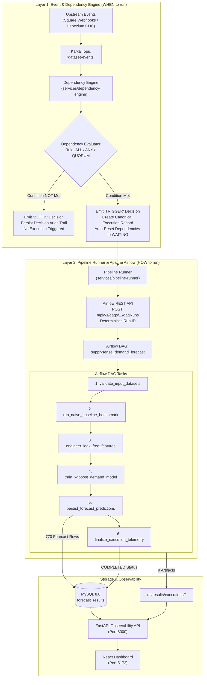

# SupplySense AI — Live Capstone Demonstration Runbook

> **Target Audience:** Capstone Presenters, Technical Evaluators, and Viva Examiners<br/>
> **Repository:** `C:\Users\varun sai\PycharmProjects\PythonProject\capstone`<br/>
> **Target Environment:** Windows 10/11 (PowerShell), Native MySQL 8.0, Docker Compose Middleware<br/>
> **Demo Duration:** 5–7 Minutes<br/>
> **Script Runner:** `scripts/demo_capstone_live.py` (`--interactive` or automated)<br/>
> **Immutable Reference Execution:** Execution #36 (Airflow Run: `supplysense_exec_36_attempt_0`)

---

## 1. System Architecture & Core Concept

### 1.1 The Operational Problem in Supply Chain Data Pipelines
In modern retail and supply-chain logistics, batch and streaming datasets originate from distributed, heterogeneous sources:
- **Point-of-Sale (POS) & E-Commerce Transactions:** Streaming or micro-batched order updates (e.g., Square webhooks).
- **Relational Inventory & Product Catalogs:** Change Data Capture (CDC) streams extracted from transactional databases (e.g., Debezium MySQL binlog connector).
- **Supplier & Logistics Updates:** Asynchronous partner updates.

Traditional data engineering approaches rely on **time-based schedulers (cron)**. Time-based triggering introduces severe failure modes:
1. **Premature Execution:** A forecasting model runs before product catalog or seller updates arrive, producing inaccurate forecasts based on stale lookups.
2. **Artificial Lag:** Schedulers are padded with conservative delays (e.g., waiting 6 hours) to guarantee upstream arrivals, forfeiting real-time responsiveness.
3. **Silent Inconsistencies:** Pipeline runners lack dependency awareness, making them blind to upstream partial outages or data loss.

### 1.2 The SupplySense AI Solution: Two-Layer Architecture
SupplySense AI decouples **pipeline eligibility** from **pipeline execution**:



### 1.3 Crucial Architectural Distinction: Dependency Engine vs. Airflow

| Dimension | Dependency Engine (`services/dependency-engine/`) | Apache Airflow (`dags/supplysense_demand_forecast.py`) |
| :--- | :--- | :--- |
| **Core Responsibility** | **WHEN** a pipeline is eligible to execute. | **HOW** the pipeline workflow actually executes. |
| **Trigger Mechanism** | Data-driven: reactive to Kafka dataset events (`Orders`, `Products`, `Sellers`). | API-driven: dispatched by the Pipeline Runner via HTTP REST API. |
| **State Evaluated** | Multi-dataset readiness (`WAITING` vs `READY`) against rules (`ALL`, `ANY`, `QUORUM`). | Workflow DAG task progression (`queued` $\to$ `running` $\to$ `success`). |
| **Output / Decision** | Emits `BLOCK` (pause) or `TRIGGER` (dispatch) to `pipeline_decisions`. | Emits task telemetry, model weights, and forecasts to `forecast_results`. |
| **Idempotency** | Prevents duplicate executions per triggering event ID. | Guarantees deterministic DAG run IDs (`supplysense_exec_<id>_attempt_0`). |
| **Failure Recovery** | Records decision audit trail; maintains dataset readiness state. | Handles task-level retries; coordinates with background Reaper process. |

---

## 2. Service Inventory & Topology

SupplySense AI runs in a hybrid topology: core messaging and workflow orchestration run in Docker Compose, while MySQL, the Observability API, and the React Dashboard run natively on Windows.

| Service | Host Port | Protocol / Path | Healthcheck Probe | Description |
| :--- | :--- | :--- | :--- | :--- |
| **MySQL Database** | `3306` | TCP (`localhost:3306/supplysense`) | PyMySQL connect | Native MySQL 8.0 storing operational tables, audit logs, and forecasts |
| **Observability API** | `8000` | HTTP `http://127.0.0.1:8000` | `GET /health` | FastAPI telemetry, pipeline query, and metadata service |
| **Swagger UI Docs** | `8000` | HTTP `http://127.0.0.1:8000/docs` | Browser navigation | Interactive OpenAPI documentation for all observability endpoints |
| **React Dashboard** | `5173` | HTTP `http://127.0.0.1:5173/` | Browser navigation | Real-time operational dashboard with 5-second auto-refresh |
| **Airflow Webserver** | `18080`* | HTTP `http://localhost:18080` | `GET /health` | Apache Airflow 2.9 web console (mapped from container `8080`) |
| **Airflow Scheduler** | — | Internal container | `docker compose ps` | Orchestrates DAG task scheduling and worker execution |
| **Airflow Postgres** | `5432` | TCP (`localhost:5432`) | `pg_isready` | Metadata storage for Apache Airflow internal state |
| **Apache Kafka** | `9092` | TCP (`localhost:9092`) | TCP socket probe | Event broker for the `dataset-events` topic |
| **Debezium Connect** | `8083` | HTTP `http://localhost:8083` | `GET /connectors` | Kafka Connect worker running the MySQL binlog connector |

> [!NOTE]
> **Port 18080 Mapping:** On Windows hosts, port `8080` is frequently occupied by background application servers. In `docker-compose.yml`, the Airflow webserver is mapped to `18080:8080`. The application `.env` configures `AIRFLOW_BASE_URL=http://localhost:18080`.

---

## 3. Pre-Demo Environment Startup & Verification

Open a PowerShell terminal with administrator/developer rights in the repository root:
```powershell
cd "C:\Users\varun sai\PycharmProjects\PythonProject\capstone"
```

### Step 3.1: Verify Native MySQL Service
Ensure native MySQL is running on port 3306:
```powershell
# Check MySQL TCP connectivity
Test-NetConnection -ComputerName 127.0.0.1 -Port 3306
```
*Expected Output:* `TcpTestSucceeded : True`

If MySQL is stopped, start the native Windows service:
```powershell
Start-Service -Name MySQL80   # or MySQL depending on local service name
```

### Step 3.2: Start Docker Middleware Services
Start Kafka, Postgres, Airflow Webserver, Airflow Scheduler, and Debezium:
```powershell
docker compose up -d kafka postgres airflow-webserver airflow-scheduler debezium
```

Verify that all containers are healthy:
```powershell
docker compose ps
```
*Expected Output:*
```text
NAME                            STATUS                    PORTS
supplysense-airflow-scheduler   Up (healthy)              8080/tcp
supplysense-airflow-webserver   Up (healthy)              0.0.0.0:18080->8080/tcp
supplysense-debezium            Up (healthy)              0.0.0.0:8083->8083/tcp
supplysense-kafka               Up (healthy)              0.0.0.0:9092->9092/tcp
supplysense-postgres            Up (healthy)              5432/tcp
```

### Step 3.3: Start FastAPI Observability Service
In a dedicated PowerShell terminal (or background process):
```powershell
.\.venv\Scripts\python.exe -m uvicorn services.observability.main:app --host 127.0.0.1 --port 8000
```
Verify health:
```powershell
curl.exe -s http://127.0.0.1:8000/health
```
*Expected Output:* `{"status":"healthy","database":"connected"}`

### Step 3.4: Start React Frontend Dashboard
In a separate dedicated PowerShell terminal:
```powershell
cd frontend
npm run dev
```
*Expected Output:*
```text
  VITE v5.x.x  ready in xxx ms
  ➜  Local:   http://localhost:5173/
```

### Step 3.5: Run Preflight and Safety Check
Before presenting, run the automated, read-only preflight check:
```powershell
.\.venv\Scripts\python.exe scripts\demo_capstone_live.py --check-only
```
*Expected Verification Output:*
```text
STEP 1: PREFLIGHT SERVICE HEALTH & ENDPOINT VALIDATION
  [PASS] MySQL Database      : Connected (localhost:3306/supplysense)
  [PASS] Observability API   : Healthy (http://127.0.0.1:8000/health) - DB: connected
  [PASS] Airflow Webserver   : Healthy (http://localhost:18080/health)
  [PASS] Airflow Forecasting : Active & Unpaused (DAG: supplysense_demand_forecast)

STEP 2: SAFETY AUDIT OF HISTORICAL BENCHMARK EXECUTION #36
  [PASS] Benchmark Execution #36 : Verified COMPLETED (Airflow Run: supplysense_exec_36_attempt_0)
  [PASS] Persisted Forecasts     : 770 rows in MySQL forecast_results
  [PASS] Scoped Artifacts        : 9 files preserved under ml/results/executions/36/

STEP 2b: STARTING DATASET STATE PRECONDITION GUARD
  [PASS] Dataset 'Orders' : Status = WAITING
  [PASS] Dataset 'Products' : Status = WAITING
  [PASS] Dataset 'Sellers' : Status = WAITING
  [PASS] All required datasets ('Orders', 'Products', 'Sellers') are in 'WAITING' state.

[CHECK-ONLY MODE] Preflight and safety checks passed. Exiting without state mutation.
```

---

## 4. Live Demonstration Step-by-Step Sequence

The live demonstration can be executed interactively (pausing between steps for presentation narration) using:
```powershell
.\.venv\Scripts\python.exe scripts\demo_capstone_live.py --interactive
```
*(Or in automated mode without prompts: `.\.venv\Scripts\python.exe scripts\demo_capstone_live.py`)*

### Screen Layout Recommendation
For maximum visual impact during the viva/presentation:
- **Left Half of Screen:** Terminal running `scripts/demo_capstone_live.py --interactive`.
- **Top Right Quadrant:** Airflow Web UI (`http://localhost:18080/dags/supplysense_demand_forecast/grid`).
- **Bottom Right Quadrant:** SupplySense AI React Dashboard (`http://localhost:5173/`).

---

### Phase 1: Preflight & Safety Guard (Step 1, 2, 2b)

#### What Happens in Code:
1. Pings MySQL, Observability API, Airflow Health, and Airflow DAG unpaused status.
2. Audits historical benchmark execution #36 to guarantee immutability (verifies 770 forecast rows and 9 files on disk).
3. Precondition Guard verifies that `Orders`, `Products`, and `Sellers` are in `WAITING` status in `dataset_metadata`.

#### Presenter Talking Points:
> *"Before ingesting new events, SupplySense AI executes an autonomous preflight safety protocol. It verifies the health of the hybrid infrastructure across MySQL, FastAPI, and Apache Airflow.*
> *Crucially, our system enforces historical benchmark immutability: execution #36, which established our baseline metrics, is verified intact with its 770 forecast rows and 9 isolated artifacts.*
> *Additionally, our Step 2b starting-state guard validates that all required datasets begin in the WAITING state, preventing false positives from corrupted prior runs."*

#### Visual Evidence:
- Terminal displays green `[PASS]` indicators across all 4 services.
- Benchmark #36 verified protected.
- Starting datasets verified `WAITING`.

---

### Phase 2: The "BLOCK" Demonstration (Step 3)

#### What Happens in Code:
1. Generates an upstream CDC transaction record for the `Orders` dataset (`olist_orders`).
2. Calls the CDC adapter (`services/cdc-adapter/adapter.py:process_cdc_event`), which registers a new version for `Orders`, sets its status to `READY`, and creates a canonical record in `dataset_events`.
3. Invokes the Dependency Engine (`services/dependency-engine/main.py:process_event`).
4. The Evaluator checks the dependency rule for the `Demand Forecast Pipeline`:
   - Rule Type: `ALL` (Requires: `Orders`, `Products`, `Sellers`).
   - Current State: `Orders` is `READY` (1 of 3), `Products` is `WAITING`, `Sellers` is `WAITING`.
5. Evaluator emits a **`BLOCK`** decision with reason `"1 of 3 required datasets are READY."`.
6. Audit record written to `pipeline_decisions`.
7. **Downstream pipeline is NOT triggered.** Zero records created in `pipeline_executions`.

#### Presenter Talking Points:
> *"Now we demonstrate the core research contribution of SupplySense AI: event-conditioned dependency governance.*
> *An upstream CDC event arrives indicating new orders have been written to the transactional database. In a traditional cron setup or naive trigger system, a demand forecast might start immediately.*
> *However, SupplySense AI evaluates our multi-dataset condition rule: 'ALL' requires Orders, Products, and Sellers to be ready.*
> *Because Products and Sellers have not yet updated, the Dependency Engine issues a strict 'BLOCK' decision. The pipeline does not run, saving computational resources and preventing premature forecasting on incomplete data.*
> *Notice that an immutable audit record is preserved in the database, documenting why execution was held."*

#### Visual Evidence:
- **Terminal:**
  ```text
  [CDC Ingestion] Canonical dataset_event #xxx created for 'Orders' (Status: READY)
  >>> Dependency Engine Decision: BLOCK
      Evaluation Reason         : 1 of 3 required datasets are READY.
    [VERIFIED] Premature downstream execution blocked: Pipeline NOT triggered.
  ```
- **React Dashboard (`http://localhost:5173/datasets`):** Shows `Orders` in green (`READY`), while `Products` and `Sellers` remain in yellow (`WAITING`).
- **React Dashboard (`http://localhost:5173/dependencies`):** Shows `Demand Forecast Pipeline` condition `ALL` (1 / 3 Ready).
- **Airflow UI (`http://localhost:18080/`):** Confirms **no** new DAG runs have been triggered.

---

### Phase 3: The "TRIGGER" & Airflow Dispatch (Step 4)

#### What Happens in Code:
1. Ingests the remaining CDC update events for `Products` and `Sellers`.
2. Evaluator detects that all 3 required datasets (`Orders`, `Products`, `Sellers`) are now `READY`.
3. Evaluator emits a **`TRIGGER`** decision with reason `"All required datasets are READY."`.
4. The Dependency Engine invokes the `Pipeline Runner` (`services/pipeline-runner/runner.py`).
5. A new canonical execution record (e.g., `#37` or `#38`) is created in `pipeline_executions` with status `RUNNING`.
6. The Dependency Engine **automatically resets** the dependency cycle: `Orders`, `Products`, and `Sellers` are restored to `WAITING` status in `dataset_metadata` to prepare for the next cycle.
7. The Pipeline Runner detects `PIPELINE_ORCHESTRATOR=AIRFLOW` and dispatches the execution via the Airflow REST API (`POST /api/v1/dags/supplysense_demand_forecast/dagRuns`) with a deterministic run ID (`supplysense_exec_<id>_attempt_0`).

#### Presenter Talking Points:
> *"Now the remaining upstream batches arrive: CDC updates for Products and Sellers are ingested.*
> *The Dependency Engine re-evaluates the condition rule. With 3 out of 3 required datasets now verified READY, the engine transitions from BLOCK to TRIGGER.*
> *Observe the coordinated sequence:*
> *First, a canonical execution record is created in our operational database.*
> *Second, the dependency cycle automatically resets all dataset statuses back to WAITING, establishing readiness for future data arrivals without manual intervention.*
> *Third, the Pipeline Runner hands off execution to our production orchestrator, Apache Airflow, through its REST API, passing a deterministic DAG run ID for end-to-end traceability."*

#### Visual Evidence:
- **Terminal:**
  ```text
  >>> Dependency Engine Decision: TRIGGER
      Evaluation Reason         : All required datasets are READY.
    [VERIFIED] Canonical Execution Record Created : #<new_id>
    [VERIFIED] Orchestrator Assigned             : AIRFLOW
    [VERIFIED] Airflow Deterministic DAG Run ID  : supplysense_exec_<new_id>_attempt_0
    [VERIFIED] Dependency Cycle Automatically Reset to WAITING for next cycle.
  ```
- **React Dashboard (`http://localhost:5173/executions`):** New execution record appears with status badge `RUNNING`, orchestrator `AIRFLOW`.

---

### Phase 4: Airflow DAG Progression Monitoring (Step 5)

#### What Happens in Code:
1. The runner polls the Airflow REST API every 4 seconds.
2. Airflow executes the 6 sequential tasks in the `supplysense_demand_forecast` DAG:
   - `validate_input_datasets`: Validates input CSVs and links execution ID.
   - `run_naive_baseline_benchmark`: Generates persistence baseline forecast.
   - `engineer_leak_free_features`: Assembles continuous weekly grid and lag/rolling features.
   - `train_xgboost_demand_model`: Trains XGBoost regressor with early stopping.
   - `persist_forecast_predictions`: Writes 770 weekly predictions into MySQL `forecast_results`.
   - `finalize_execution_telemetry`: Emits metrics summary and marks execution `COMPLETED`.
3. The runner prints live status progression for every task until completion.

#### Presenter Talking Points:
> *"Here we observe live task progression in Apache Airflow.*
> *The DAG executes six strictly sequential, idempotent tasks:*
> *It validates raw inputs, computes our naive baseline benchmark, performs leak-free feature engineering across 73 product categories, trains our XGBoost model, persists 770 forecast rows into MySQL, and finalizes telemetry.*
> *Each task executes in an isolated environment, ensuring robust failure containment."*

#### Visual Evidence:
- **Terminal:**
  ```text
  STEP 5: AIRFLOW DAG RUN PROGRESSION (supplysense_demand_forecast)
  Monitoring Airflow DAG Run: 'supplysense_exec_<new_id>_attempt_0'...
    [004s] DAG State: RUNNING -> validate_input_datasets: running
    [012s] DAG State: RUNNING -> run_naive_baseline_benchmark: success | engineer_leak_free_features: running
    [024s] DAG State: RUNNING -> train_xgboost_demand_model: running
    [036s] DAG State: RUNNING -> persist_forecast_predictions: running
    [044s] DAG State: SUCCESS -> finalize_execution_telemetry: success
  Airflow DAG Run completed with state: SUCCESS (44s elapsed)
  ```
- **Airflow Grid UI (`http://localhost:18080/`):** The DAG run column transitions from light green (running) to solid dark green (success) across all 6 task rows.

---

### Phase 5: Post-Run Verification & Observability (Step 6 & 7)

#### What Happens in Code:
1. Queries MySQL `pipeline_executions` to verify final status is `COMPLETED`.
2. Queries MySQL `forecast_results` for the new execution ID: verifies exactly 770 forecast rows covering 70 product categories.
3. Checks filesystem under `ml/results/executions/<new_id>/`: confirms all 9 isolated artifacts were written.
4. Queries FastAPI Observability endpoint `http://127.0.0.1:8000/api/observability/executions/<new_id>` to verify API resolution.
5. Verifies benchmark execution #36 was **not** touched and remains intact.

#### Presenter Talking Points:
> *"Finally, we verify end-to-end data integrity across persistence and observability:*
> *In MySQL, exactly 770 forecast predictions have been persisted under the new execution ID across 70 product categories.*
> *On disk, nine isolated artifacts—including model binaries, prediction CSVs, and metrics comparisons—have been saved into an execution-scoped folder, preventing artifact contamination.*
> *In our React dashboard, evaluators can immediately explore both the new execution and historical benchmarks.*
> *And critically, historical execution #36 remains pristine and untouched, proving the strict idempotency and isolation of our platform."*

#### Visual Evidence:
- **Terminal:**
  ```text
  STEP 6: POST-RUN AUDIT & TELEMETRY VERIFICATION (EXECUTION #<new_id>)
    [PASS] Execution #<new_id> Status : COMPLETED (Orchestrator: AIRFLOW)
    [PASS] Forecast Predictions       : 770 rows persisted (Model: XGBoost xgboost-v1)
    [PASS] Product Categories         : 70 categories covered
    [PASS] Artifact Isolation         : 9 files preserved under ml/results/executions/<new_id>/
           - baseline_metrics.csv
           - baseline_metrics.json
           - baseline_test_predictions.csv
           - baseline_validation_predictions.csv
           - model_comparison.json
           - xgboost_demand_model.json
           - xgboost_metrics.json
           - xgboost_test_predictions.csv
           - xgboost_validation_predictions.csv
    [PASS] Observability API          : Live query resolved
    [PASS] Benchmark Integrity        : Execution #36 remains untouched (COMPLETED, 770 forecast rows)
  ```
- **React Dashboard (`http://localhost:5173/forecasts`):** Select the newly created execution ID from the dropdown; view interactive weekly demand charts and category tables.

---

## 5. Key URLs & Evaluation Endpoints

Keep these URLs bookmarked or open in browser tabs during the demonstration:

| Interface | URL | Purpose / Evidence |
| :--- | :--- | :--- |
| **SupplySense Dashboard** | `http://127.0.0.1:5173/` | System overview, health status, quick stats |
| **Execution History** | `http://127.0.0.1:5173/executions` | Real-time execution log showing orchestrator, trigger event ID, status |
| **Dataset Inventory** | `http://127.0.0.1:5173/datasets` | Live dataset status (`WAITING` vs `READY`) and versions |
| **Dependency Rules** | `http://127.0.0.1:5173/dependencies` | Dependency engine rule matrix (`ALL` condition, 3 required datasets) |
| **Forecast Explorer** | `http://127.0.0.1:5173/forecasts` | Visual forecast exploration across 70 product categories |
| **FastAPI Swagger Docs** | `http://127.0.0.1:8000/docs` | OpenAPI documentation for programmatic evaluation |
| **Airflow DAG Grid** | `http://localhost:18080/dags/supplysense_demand_forecast/grid` | Visual DAG execution grid showing all 6 task states |
| **Airflow Health Endpoint**| `http://localhost:18080/health` | JSON health check of Airflow webserver and metadatabase |

---

## 6. Troubleshooting & Safe-Abort Procedure

### 6.1 Common Preflight Issues & Remediation

| Issue | Symptom | Action & Resolution Command |
| :--- | :--- | :--- |
| **MySQL Connection Refused** | `[FAIL] MySQL Database: Connection failed (localhost:3306)` | Ensure native Windows MySQL is running: `Start-Service MySQL80` or start via `services.msc`. |
| **Observability API Offline** | `[FAIL] Observability API: Unreachable (http://127.0.0.1:8000/health)` | Launch FastAPI service in a background terminal: `.\.venv\Scripts\python.exe -m uvicorn services.observability.main:app --host 127.0.0.1 --port 8000`. |
| **Airflow Webserver Unreachable** | `[FAIL] Airflow Webserver: Unreachable (http://localhost:18080/health)` | Check Docker: `docker compose ps`. Restart webserver if necessary: `docker compose restart airflow-webserver`. Verify port mapping `18080:8080`. |
| **Airflow DAG Paused** | `[FAIL] Airflow Forecasting: DAG 'supplysense_demand_forecast' is PAUSED` | Unpause via Airflow UI (`http://localhost:18080/`) toggle switch, or run inside container: `docker compose exec airflow-webserver airflow dags unpause supplysense_demand_forecast`. |
| **Starting-State Guard Fails** | `[FAIL] Precondition violated: Dataset 'X' has status 'READY'` | **Normal Action: Abort and investigate.** Do NOT routinely reset. A non-`WAITING` status indicates unconsumed upstream events or an interrupted prior run. Follow Section 6.2 for read-only diagnosis. |

---

### 6.2 Precondition Investigation & Exceptional Manual Recovery

When the runner's Step 2b starting-state guard detects that one or more required datasets (`Orders`, `Products`, `Sellers`) are not in `WAITING` status, **the intended and normal response is to abort and investigate**.

> [!IMPORTANT]
> **Policy on Dataset State Resets:**
> - Resetting dataset statuses must **NEVER** be treated as a routine pre-demo step.
> - The live demo runner (`scripts/demo_capstone_live.py`) **never** automatically modifies, resets, or forces dataset statuses during preflight.
> - State-changing recovery is an **exceptional, manual operation** requiring explicit operator inspection and approval.
> - Never execute recovery commands while upstream event producers (Square webhooks or Debezium CDC) are actively streaming data.

#### Step 6.2.1: Read-Only Diagnostic Inspection (Safe to Run)
Before taking any corrective action, execute the following read-only diagnostic query to inspect current dataset statuses, version counters, and recent event arrivals:

```powershell
.\.venv\Scripts\python.exe -c "
from common.database import get_connection

conn = get_connection()
cur = conn.cursor()

# 1. Inspect required dataset metadata
cur.execute('''
    SELECT dataset_name, status, current_version, last_updated_at, updated_at
    FROM dataset_metadata
    WHERE dataset_name IN ('Orders', 'Products', 'Sellers')
    ORDER BY dataset_name
''')
print('=== DATASET METADATA STATUS ===')
for row in cur.fetchall():
    print(f\"{row['dataset_name']:<10} | Status: {row['status']:<8} | Version: {row['current_version']:<4} | Updated: {row['updated_at']}\")

# 2. Inspect recent dataset events
cur.execute('''
    SELECT event_id, dataset_name, dataset_version, source_change_id, received_at
    FROM dataset_events
    ORDER BY event_id DESC LIMIT 5
''')
print('\n=== RECENT DATASET EVENTS ===')
for e in cur.fetchall():
    print(f\"Event #{e['event_id']:<5} | {e['dataset_name']:<10} v{e['dataset_version']:<3} | Received: {e['received_at']}\")

# 3. Inspect recent pipeline decisions
cur.execute('''
    SELECT decision_id, pipeline_name, decision, reason, evaluated_at
    FROM pipeline_decisions
    ORDER BY decision_id DESC LIMIT 3
''')
print('\n=== RECENT PIPELINE DECISIONS ===')
for d in cur.fetchall():
    print(f\"Decision #{d['decision_id']:<5} | {d['decision']:<7} | Reason: {d['reason']}\")

conn.close()
"
```

#### Diagnostic Evaluation Path:
1. **Case A — Incomplete Dependency Cycle from Interrupted Run:** If the diagnostic queries confirm that no active event stream is running and that a leftover `READY` state was left behind by an aborted prior test run, proceed to Step 6.2.2 only after explicit presenter/operator approval.
2. **Case B — Live Upstream Events Active:** If new CDC or webhook events are actively arriving, do not reset. Allow the upstream producers to satisfy the remaining datasets or trigger the pipeline naturally.

#### Step 6.2.2: Exceptional State-Changing Recovery (Requires Explicit Operator Approval)

> [!WARNING]
> **State-Changing Manual Remediation:**
> Execute this query **only** after completing the diagnostic inspection above and confirming that no background ingestion is active. This query modifies `status` in `dataset_metadata` to re-align with the baseline requirement. It does NOT delete or alter historical execution records or benchmark execution #36.

```powershell
# EXCEPTIONAL MANUAL OPERATION ONLY — Requires explicit operator approval
.\.venv\Scripts\python.exe -c "
from common.database import get_connection

conn = get_connection()
cur = conn.cursor()

cur.execute('''
    UPDATE dataset_metadata
    SET status = 'WAITING'
    WHERE dataset_name IN ('Orders', 'Products', 'Sellers')
''')
conn.commit()
print(f'Manual recovery completed. Rows updated: {cur.rowcount}')

conn.close()
"
```

After manual recovery, re-verify readiness using the read-only preflight command:
```powershell
.\.venv\Scripts\python.exe scripts\demo_capstone_live.py --check-only
```

---

### 6.3 Safe-Abort Procedure & Timeout Handling

#### 6.3.1 Behavior on Interruption (`Ctrl+C`)
If the live demonstration must be halted midway (e.g., presenter interruption or terminal disconnect):
1. **Press `Ctrl+C` in the runner terminal.**
2. **Implementation Guarantees (What the Runner Cleans Up):**
   - The runner's `finally:` block executes automatically.
   - It restores the environment variable `PIPELINE_ORCHESTRATOR` and in-memory module configuration back to its original value (`LOCAL`).
   - It closes its active PyMySQL database connection.
3. **Important Limitations (What is NOT Rolled Back or Cancelled):**
   - **No Database Transaction Rollback:** Database records that have already been committed (e.g., canonical `dataset_events`, `dataset_metadata` version increments, or `pipeline_decisions`) remain committed in MySQL.
   - **No Remote Airflow Cancellation:** If `Ctrl+C` occurs after Step 4 (Airflow dispatch), Apache Airflow continues executing the DAG run asynchronously inside Docker. The runner does not issue a cancellation request to the Airflow REST API on exit. If desired, the operator can manually terminate the DAG run from the Airflow Web UI (`http://localhost:18080/`).
   - **No Partial Artifact Deletion:** Any intermediate files written to disk are preserved and not automatically deleted.

#### 6.3.2 Behavior on Polling Timeout
- If the dispatched Airflow DAG run does not reach `success` or `failed` within `timeout_seconds` (default: 180 seconds, configurable via `--timeout <seconds>`), `monitor_airflow_dag_run()` raises a `TimeoutError`.
- The `finally:` block executes, restoring orchestrator settings and closing the database connection.
- The Airflow DAG may still be running in the background. The presenter should open `http://localhost:18080/dags/supplysense_demand_forecast/grid` to inspect task-level logs directly.

#### 6.3.3 Historical Benchmark Protection Verification
Under any abort or interruption scenario, verify that benchmark execution #36 remains untouched:
```powershell
.\.venv\Scripts\python.exe -c "
from common.database import get_connection
conn = get_connection()
cur = conn.cursor()
cur.execute('SELECT execution_id, status FROM pipeline_executions WHERE execution_id = 36')
print('Exec 36 Record:', cur.fetchone())
cur.execute('SELECT COUNT(*) AS cnt FROM forecast_results WHERE execution_id = 36')
print('Exec 36 Forecast Rows:', cur.fetchone()['cnt'])
conn.close()
"
```
*Expected Result:* Status `COMPLETED`, Forecast Rows `770`.

---

## 7. Status Summary: Verified vs. Upcoming Demonstration

To maintain total documentation accuracy and academic integrity:

| Capability / Flow | Current Status | Empirical Evidence |
| :--- | :--- | :--- |
| **All Unit & Integration Tests** | **VERIFIED** | 237/237 tests passing with exit code 0 across 14 modules. |
| **Historical Benchmark Isolation** | **VERIFIED** | Execution #36 verified with 770 forecast rows in MySQL and 9 files preserved in `ml/results/executions/36/`. |
| **Preflight Health Probes** | **VERIFIED** | Preflight passes with HTTP 200 checks on native MySQL, FastAPI, and containerized Airflow. |
| **Starting-State Precondition Guard** | **VERIFIED** | Step 2b verified live: enforces read-only check of `Orders`, `Products`, and `Sellers` in `WAITING` state; aborts safely on non-WAITING or DB error. |
| **Airflow Response Hardening** | **VERIFIED** | `AirflowClient` accepts both HTTP 200 and 201 responses; verified in Phase D3/D4. |
| **Historical Live Airflow Dispatch** | **VERIFIED** | Successfully executed on live infrastructure in Phase D2 (Execution #36) with deterministic DAG run ID `supplysense_exec_36_attempt_0`. |
| **Live Capstone Presentation Rehearsal** | **PENDING LIVE PRESENTATION** | Full live execution of `scripts/demo_capstone_live.py` (which creates a new execution such as `#37`) is verified in unit tests with mock adapters, and is scheduled for execution during the live presentation / full rehearsal. |
